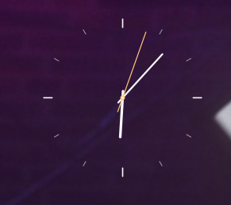

<div align="center">

# 🕐 Desktop Clock

**ساعة كلاسيكية أنيقة لسطح مكتب ويندوز — شفافة، بلا حدود، وبلا شريط مهام**

[](https://www.python.org/)
[](https://pypi.org/project/PyQt6/)
[]()
[](LICENSE)



</div>

---

## ✨ نظرة عامة

**Desktop Clock** هو ودجت سطح مكتب خفيف يضيف لمسة من الأناقة إلى شاشتك. يجمع بين بساطة التصميم الكلاسيكي وحداثة الشفافية الكاملة — بدون إطارات، بدون خلفيات، وبدون أي أثر في شريط المهام.

---

## 🎯 المميزات

- 🎨 **شفافية كاملة** — الساعة فقط، لا خلفية ولا إطار
- 🖱️ **سحب وتغيير حجم** — حرّكها وكبّرها بحرية
- ⚙️ **قائمة سياقية** — تحكم كامل من كليك يمين واحد
- 💾 **حفظ تلقائي** — الموقع والحجم يبقيان كما تركتهما
- 🚫 **بلا شريط مهام** — لا أيقونة، لا إزعاج
- ⏱️ **حركة سلسة** — عقارب تتحرك بانسيابية
- 🪟 **متوافق مع Windows 10 و 11**

---

## 🚀 التثبيت

```bash
# استنسخ المشروع
git clone https://github.com/Turki-Alshaikh/desktop-clock.git
cd desktop-clock

# أنشئ بيئة افتراضية
python -m venv venv
venv\Scripts\activate

# ثبّت المتطلبات
pip install -r requirements.txt

# شغّل الساعة
python desktop_clock.py
```

> 💡 اضغط `Win + D` لرؤية الساعة على سطح المكتب.

---

## 🎮 الاستخدام

| الإجراء | النتيجة |
|:---:|:---|
| **سحب بالزر الأيسر** | تحريك الساعة |
| **عجلة الفأرة** | تكبير / تصغير |
| **كليك يمين** | قائمة التحكم |
| **`Win + D`** | إظهار سطح المكتب |

من قائمة الزر الأيمن يمكنك إظهار/إخفاء الثواني، تغيير الحجم، أو إغلاق الساعة.

---

## 🛠️ التخصيص

كل الإعدادات قابلة للتعديل من داخل `desktop_clock.py`:

- **الألوان**: `color_main` و `color_accent`
- **الحجم الافتراضي**: قيمة `size` في `QSettings`
- **الثواني**: `show_seconds = True/False`

---

## 🐛 استكشاف الأخطاء

<details>
<summary><b>الساعة لا تظهر</b></summary>

اضغط `Win + D`. الساعة مصممة لتكون خلف التطبيقات، لذلك لن تراها أثناء استخدام برنامج آخر.

</details>

<details>
<summary><b>تظهر رسائل [warn] في الطرفية</b></summary>

هذه رسائل تشخيصية وليست أخطاء — تظهر على الأنظمة الأقدم من Windows 11 والكود يتجاوزها تلقائيًا.

</details>

---

## 🗺️ خارطة الطريق

- [x] ساعة كلاسيكية شفافة
- [x] إزالة كاملة للإطار
- [x] سحب وتغيير حجم
- [ ] أوضاع مظهر متعددة
- [ ] تشغيل تلقائي مع Windows
- [ ] بناء EXE بنقرة واحدة

---

## 🤝 المساهمة

المساهمات مرحب بها! افتح Issue أو Pull Request، وسنراجعها بكل سرور.

---

## 📄 الترخيص

هذا المشروع مرخص تحت **MIT License** — راجع [LICENSE](LICENSE).

---


